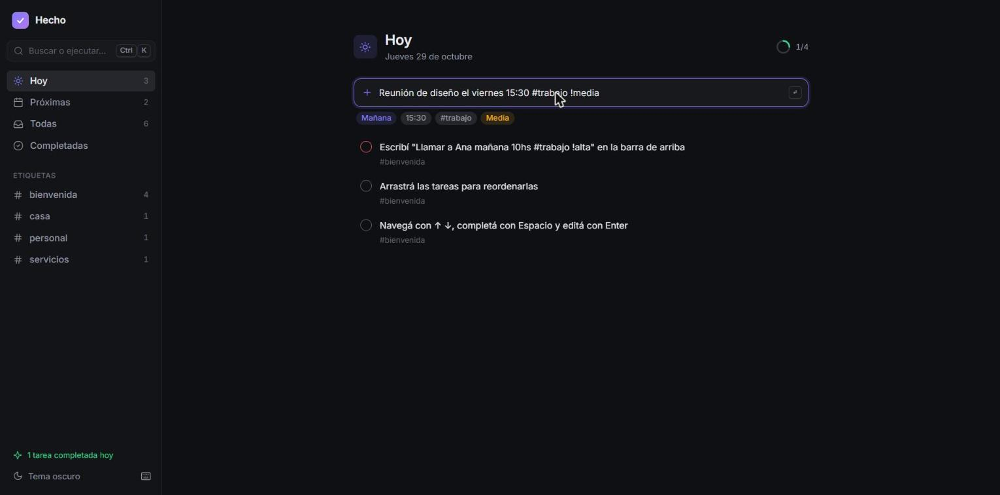

# Hecho

Gestor de tareas rápido y pensado para usarse con el teclado. Escribís una línea en lenguaje natural y la app entiende la fecha, la hora, las etiquetas y la prioridad.



<!-- Demo: agregar acá el link de Netlify -->

> `Pagar la luz mañana 18hs #casa !alta`

| Título       | Fecha  | Hora  | Etiqueta | Prioridad |
| ------------ | ------ | ----- | -------- | --------- |
| Pagar la luz | Mañana | 18:00 | casa     | Alta      |

## Funcionalidades

- **Carga en lenguaje natural (en español):** `hoy`, `mañana`, `pasado mañana`, `el viernes`, `el próximo lunes`, `en 3 días`, `la semana que viene`, `15/11`, `5 de diciembre`; horas como `18hs`, `18:30`, `a las 9`, `7pm`; etiquetas con `#` y prioridad con `!alta`, `!media`, `!baja`. Mientras escribís, la app muestra lo que va a interpretar.
- **Vistas:** Hoy (con vencidas y progreso del día), Próximas (agrupadas por día), Todas, Completadas y una vista por etiqueta.
- **Paleta de comandos (`Ctrl K`):** busca tareas, navega entre vistas, cambia el tema y exporta los datos.
- **Pensada para el teclado:** se puede hacer todo sin el mouse (ver atajos abajo).
- **Arrastrar y soltar** para ordenar las tareas, también con el dedo en el celular.
- **Deshacer** al completar o eliminar.
- **Edición en línea** que también entiende lenguaje natural (`... mañana #super` agrega fecha y etiqueta).
- **Modo claro, oscuro y del sistema.**
- **PWA:** se instala en el celular o la computadora y funciona sin conexión.
- **Responsive**, con menú lateral deslizable en pantallas chicas.
- **Accesible:** roles ARIA, foco visible, avisos con `aria-live` y respeto por `prefers-reduced-motion`.

## Atajos de teclado

| Atajo           | Acción                            |
| --------------- | --------------------------------- |
| `Ctrl K` / `/`  | Paleta de comandos                |
| `N`             | Nueva tarea                       |
| `1` `2` `3` `4` | Hoy, Próximas, Todas, Completadas |
| `↑` `↓`         | Moverse entre tareas              |
| `Espacio`       | Completar                         |
| `Enter`         | Editar                            |
| `P` / `D`       | Prioridad / fecha                 |
| `Supr`          | Eliminar                          |
| `T`             | Cambiar tema                      |
| `?`             | Ver todos los atajos              |

## Stack

- **Angular 22**, con componentes standalone, **signals** para todo el estado, **zoneless** (sin zone.js) y la sintaxis de control de flujo `@if` / `@for`.
- **Angular CDK** para arrastrar y soltar, diálogos y manejo del foco.
- **Animaciones nativas** de Angular (`animate.enter` / `animate.leave`) con CSS, sin `@angular/animations`.
- **SCSS** con un sistema de tokens de diseño (variables CSS) para los temas claro y oscuro.
- **Vitest** para los tests unitarios y de componentes.
- **Service Worker** de Angular para el modo sin conexión.
- **GitHub Actions** verifica formato, tests y build en cada push.

## Decisiones técnicas

- **Sin backend, local-first.** Los datos se guardan en `localStorage` mediante un servicio aislado (`TaskStorage`), así que sumar sincronización en la nube más adelante no requiere tocar la interfaz. La app migra automáticamente los datos de la versión anterior.
- **Un único store con signals** (`TaskStore`): las vistas (Hoy, Próximas, etiquetas, contadores) son `computed` derivados de una sola lista de tareas, sin estado duplicado.
- **Parser propio en vez de una librería.** Las librerías de fechas en lenguaje natural están pensadas para inglés; el parser de Hecho entiende expresiones rioplatenses, respeta acentos y está cubierto por tests de cada caso.
- **Fechas como `YYYY-MM-DD` locales**, no timestamps, para evitar errores de zona horaria (una tarea "para hoy" no cambia de día según el huso).
- **Reordenamiento estable:** al arrastrar dentro de una vista filtrada, solo se reasignan las posiciones de esas tareas, sin desordenar las demás.

## Desarrollo

```bash
npm install
npm start          # http://localhost:4200
npm test           # tests en modo watch
npm run test:ci    # tests una sola vez
npm run build      # build de producción en dist/hecho/browser
```

## Deploy

El proyecto incluye `netlify.toml`: al conectar el repositorio en Netlify, el build y la carpeta a publicar se configuran solos.

---

Íconos basados en [Lucide](https://lucide.dev) (licencia ISC).
