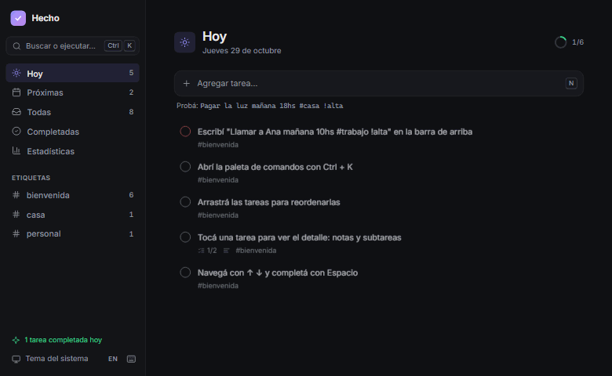
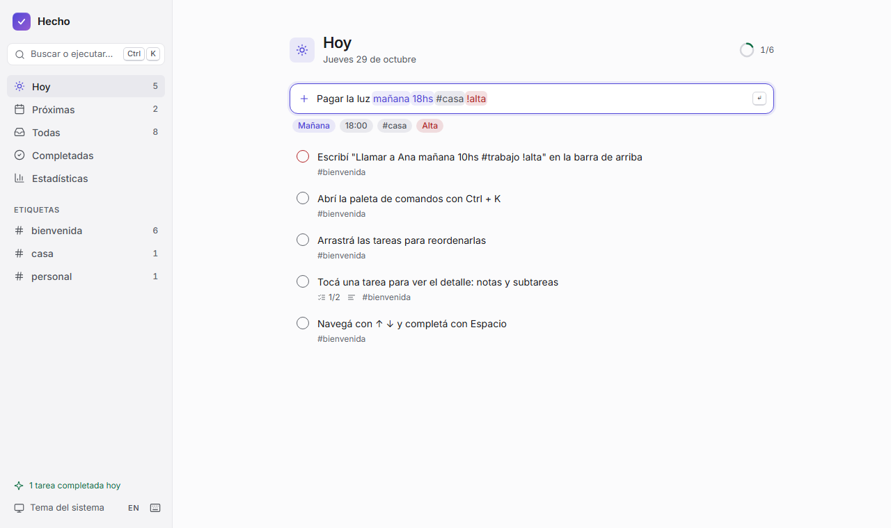
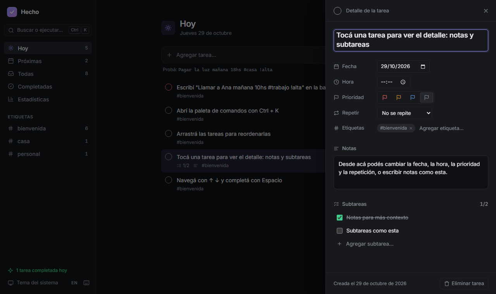
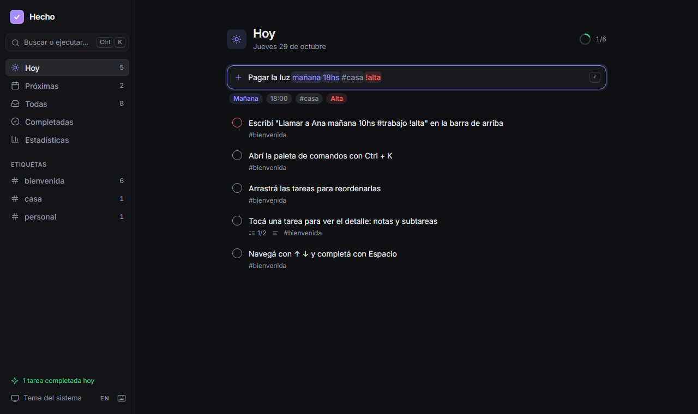
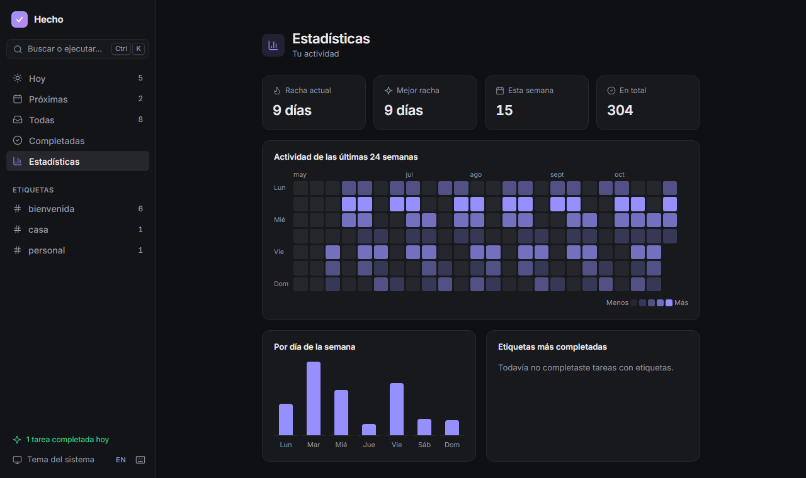

# Hecho

[](https://github.com/HugoEseverri/ToDoList/actions/workflows/ci.yml)


Gestor de tareas rápido y pensado para el teclado. Escribís una línea en lenguaje natural, en español o en inglés, y Hecho entiende la fecha, la hora, la repetición, las etiquetas y la prioridad mientras escribís.

<!-- Demo en vivo: agregar acá el link de Netlify -->



| Lo que escribís                             | Lo que entiende                                      |
| ------------------------------------------- | ---------------------------------------------------- |
| `Pagar la luz mañana 18hs #casa !alta`      | Mañana · 18:00 · #casa · prioridad alta              |
| `Sacar la basura todos los lunes 21hs`      | Se repite todos los lunes, empieza el próximo, 21:00 |
| `Pagar alquiler cada mes el 10`             | Todos los meses el día 10                            |
| `Gimnasio días de semana a las 7`           | De lunes a viernes, 07:00                            |
| `Call Ana tomorrow 10am #work !high` _(EN)_ | Tomorrow · 10:00 · #work · high priority             |

## Capturas

| Tema claro                                            | Panel de detalle                                                         |
| ----------------------------------------------------- | ------------------------------------------------------------------------ |
|  |     |
| **Tema oscuro**                                       | **Estadísticas**                                                         |
|  |  |

## Funcionalidades

- **Carga en lenguaje natural** con resaltado en vivo: cada parte reconocida se colorea dentro del mismo campo de texto.
  - Fechas: `hoy`, `mañana`, `pasado mañana`, `el viernes`, `el próximo lunes`, `en 3 días`, `la semana que viene`, `15/11`, `5 de diciembre`, `desde el 15/11`.
  - Horas: `18hs`, `18:30`, `a las 9`, `7pm`.
  - Repeticiones: `todos los días`, `días de semana`, `todos los lunes`, `cada 2 semanas`, `cada mes el 10`, `todos los años`.
  - Etiquetas con `#` y prioridad con `!alta`, `!media`, `!baja`.
- **Tareas repetitivas:** al completarlas queda el registro en Completadas y la tarea pasa sola a su próxima fecha (el 31 cae en el último día de los meses cortos, sin "correrse").
- **Panel de detalle** con notas, subtareas, fecha, hora, prioridad, repetición y etiquetas.
- **Vistas:** Hoy (con vencidas y progreso del día), Próximas (agrupadas por día), Todas, Completadas y una por etiqueta.
- **Estadísticas:** racha actual y mejor racha, mapa de actividad de 24 semanas, actividad por día de la semana y etiquetas más completadas.
- **Paleta de comandos (`Ctrl K`):** busca tareas y ejecuta cualquier acción (navegar, tema, idioma, exportar, importar, recordatorios).
- **Español e inglés:** toda la interfaz y el parser cambian en vivo (`L`). En la primera visita se usa el idioma del navegador.
- **Pensada para el teclado** (atajos abajo) y **arrastrar y soltar** para ordenar, también con el dedo.
- **Deshacer** al completar, eliminar, importar o borrar completadas.
- **Recordatorios** con notificaciones del sistema para tareas con hora.
- **Exportar e importar** las tareas en JSON.
- **PWA:** se instala y funciona sin conexión.
- **Modo claro, oscuro y del sistema**, y diseño responsive con menú deslizable en el celular.

## Atajos de teclado

| Atajo               | Acción                                          |
| ------------------- | ----------------------------------------------- |
| `Ctrl K` / `/`      | Paleta de comandos                              |
| `N`                 | Nueva tarea                                     |
| `1` `2` `3` `4` `5` | Hoy, Próximas, Todas, Completadas, Estadísticas |
| `↑` `↓`             | Moverse entre tareas                            |
| `Espacio`           | Completar                                       |
| `Enter`             | Abrir el detalle                                |
| `E`                 | Editar el título                                |
| `P` / `D`           | Prioridad / fecha                               |
| `Supr`              | Eliminar                                        |
| `T` / `L`           | Cambiar tema / idioma                           |
| `?`                 | Ver todos los atajos                            |

## Stack

- **Angular 22**: componentes standalone, **signals** para todo el estado, **zoneless** (sin zone.js), control de flujo `@if` / `@for` y animaciones nativas (`animate.enter` / `animate.leave`).
- **Angular CDK** para arrastrar y soltar, diálogos y manejo del foco.
- **SCSS** con tokens de diseño (variables CSS) para los temas claro y oscuro.
- **Vitest** para tests unitarios y de componentes, y **Playwright** para tests de punta a punta.
- **axe-core** y **Lighthouse CI** para auditar accesibilidad y rendimiento.
- **ESLint** (angular-eslint, incluidas sus reglas de accesibilidad en templates) y **Prettier**.
- **Service Worker** de Angular para el modo sin conexión.

## Calidad

Cada push corre en GitHub Actions:

1. **Formato y lint**.
2. **~150 tests unitarios y de componentes** (parser en los dos idiomas, repeticiones, estadísticas, store, componentes).
3. **Tests de punta a punta** en Chromium de escritorio y en un celular emulado: flujos completos, persistencia, arrastrar y soltar, teclado, idioma.
4. **Auditoría de accesibilidad** con axe (WCAG 2.2 AA) de cada vista, el panel de detalle y la paleta, en tema claro y oscuro.
5. **Lighthouse** con umbrales mínimos: rendimiento ≥ 90, accesibilidad = 100, buenas prácticas ≥ 95, SEO ≥ 90.

Los colores de texto se eligieron calculando el contraste contra cada superficie: todos cumplen 4,5:1 en los dos temas.

## Decisiones técnicas

- **Sin backend, local-first.** Los datos viven en `localStorage` detrás de un servicio aislado (`TaskStorage`): sumar sincronización en la nube no requiere tocar la interfaz. Los datos de versiones anteriores se migran y validan al cargar.
- **Un único store con signals** (`TaskStore`): Hoy, Próximas, etiquetas y contadores son `computed` derivados de una sola lista, sin estado duplicado. Cada operación devuelve su propia función para deshacerla.
- **Parser propio en vez de una librería.** Las librerías de fechas en lenguaje natural están pensadas para inglés; el de Hecho entiende expresiones rioplatenses, respeta acentos, devuelve la posición de cada token para el resaltado y está cubierto por tests de cada caso.
- **Resaltado sin librerías de edición:** una capa con el mismo texto y la misma tipografía detrás de un input transparente; un test verifica que ambos textos coincidan carácter por carácter, para que el cursor nunca quede corrido.
- **Fechas como `YYYY-MM-DD` locales**, no timestamps: una tarea "para hoy" no cambia de día según el huso horario.
- **Traducciones en tiempo de ejecución** con un signal de idioma, en lugar del i18n de compilación de Angular (que genera un build por idioma): el cambio es instantáneo y la demo funciona para cualquier visitante.
- **Carga diferida:** la paleta de comandos, los atajos, las estadísticas y el CDK Dialog se descargan recién al usarse. La carga inicial pesa ~118 kB comprimidos.
- **Recordatorios:** sin un servidor de push, las notificaciones funcionan mientras la app está abierta (en una pestaña o instalada como PWA). Es una limitación conocida del enfoque sin backend.

## Desarrollo

```bash
npm install
npm start            # http://localhost:4200
npm test             # tests unitarios en modo watch
npm run test:ci      # tests unitarios una sola vez
npm run e2e          # tests de punta a punta y accesibilidad (Playwright)
npm run lint
npm run lighthouse   # build + Lighthouse CI
npm run build        # build de producción en dist/hecho/browser
npm run demo         # regenera el GIF y las capturas del README (con la app corriendo)
```

## Deploy

El proyecto incluye `netlify.toml`: al conectar el repositorio en Netlify, el build y la carpeta a publicar se configuran solos. Después del primer deploy, conviene cambiar `og:image` en `src/index.html` por la URL absoluta (`https://<tu-sitio>/og-image.png`) para que la vista previa del link funcione en todas las redes.

---

Íconos basados en [Lucide](https://lucide.dev) (licencia ISC).
